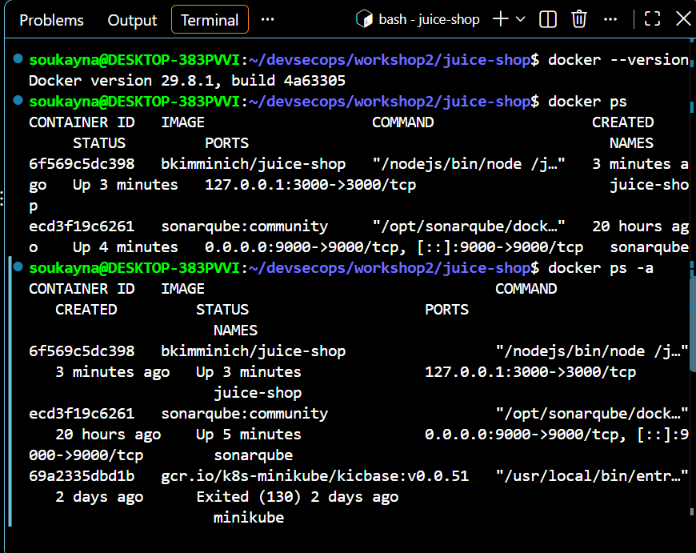
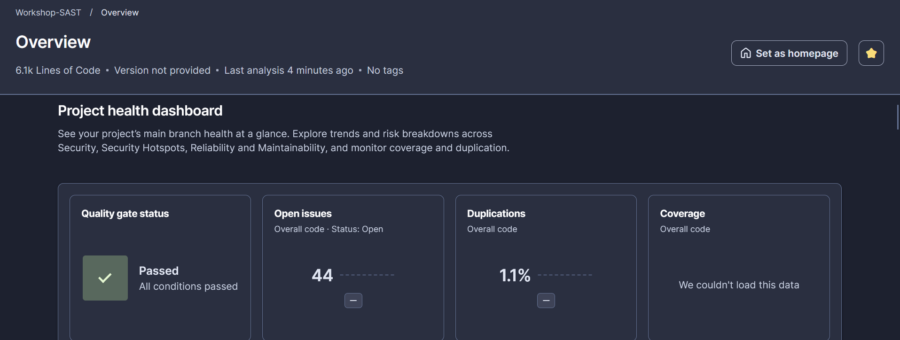
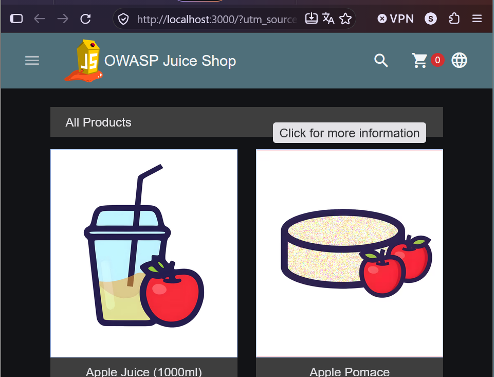
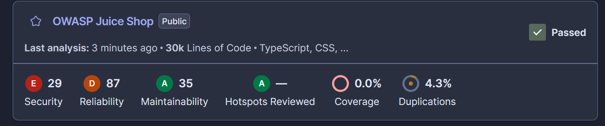
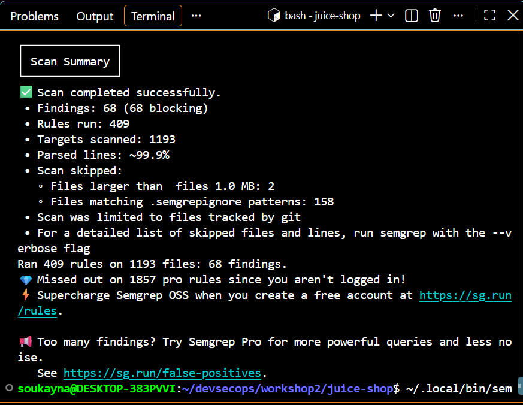
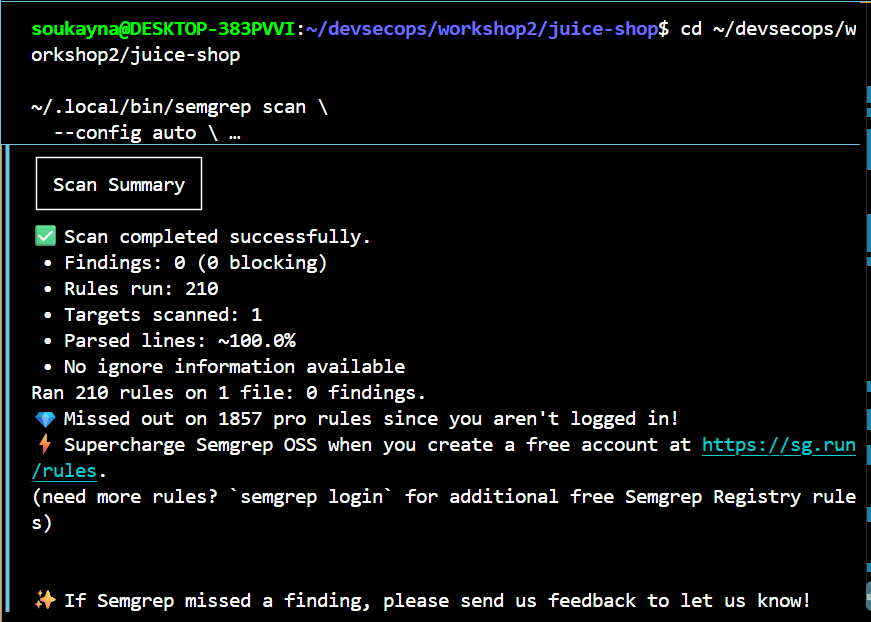
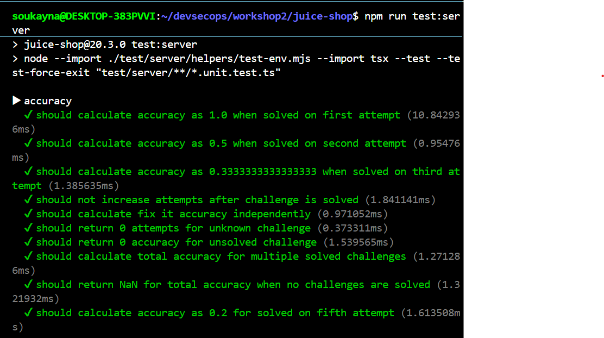
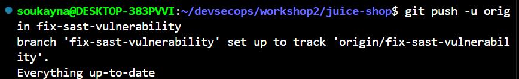
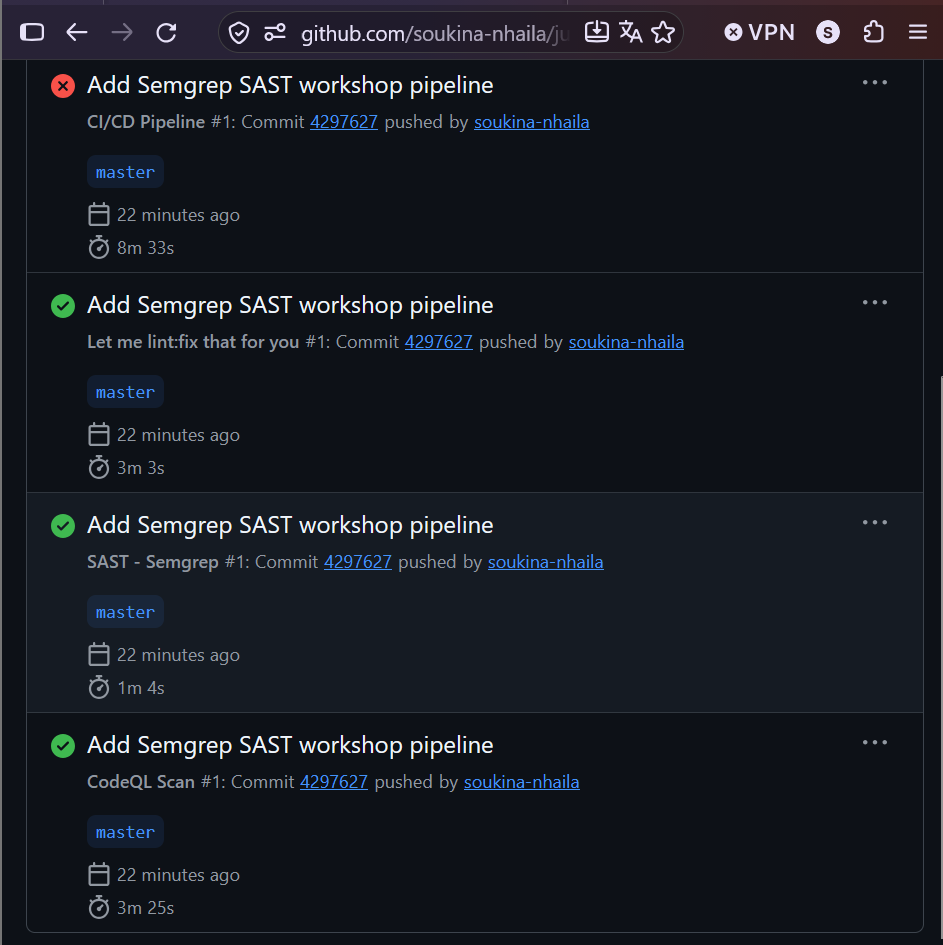
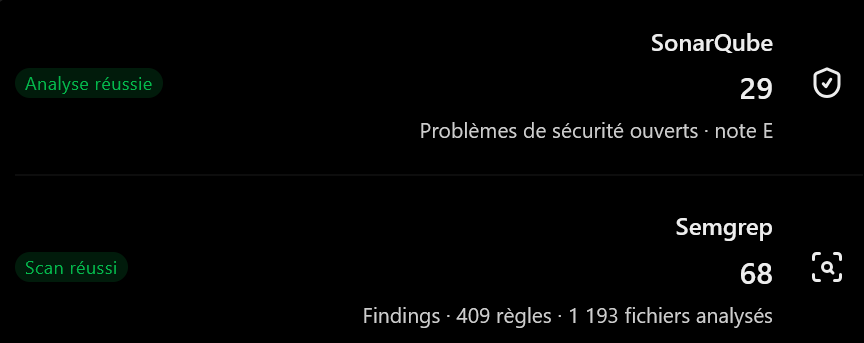

# Atelier DevSecOps : Analyse SAST avec SonarQube et Semgrep

## Table des matières

1. [Introduction](#1-introduction)
2. [Objectifs de l’atelier](#2-objectifs-de-latelier)
3. [Environnement technique](#3-environnement-technique)
4. [Préparation de l’environnement avec Docker](#4-préparation-de-lenvironnement-avec-docker)
5. [Analyse statique avec SonarQube](#5-analyse-statique-avec-sonarqube)
6. [Analyse de sécurité avec Semgrep](#6-analyse-de-sécurité-avec-semgrep)
7. [Étude et correction d’une injection SQL](#7-étude-et-correction-dune-injection-sql)
8. [Vérification après correction](#8-vérification-après-correction)
9. [Exécution des tests](#9-exécution-des-tests)
10. [Intégration avec Git et GitHub](#10-intégration-avec-git-et-github)
11. [Intégration continue avec GitHub Actions](#11-intégration-continue-avec-github-actions)
12. [Comparaison des outils](#12-comparaison-des-outils)
13. [Difficultés rencontrées et limites](#13-difficultés-rencontrées-et-limites)
14. [Conclusion](#14-conclusion)


---

## 1. Introduction

Le DevSecOps consiste à intégrer les pratiques de sécurité dans l’ensemble du cycle de développement logiciel. L’objectif est de détecter les vulnérabilités le plus tôt possible, dès l’écriture et la validation du code source, plutôt que d’attendre la mise en production.

Cet atelier porte sur le **SAST (Static Application Security Testing)**, une méthode d’analyse statique qui examine le code source sans nécessiter l’exécution normale de l’application pour identifier des constructions potentiellement dangereuses.

Deux outils sont utilisés dans cet atelier :

- **SonarQube** : analyse du code source et suivi des problèmes de sécurité, de fiabilité et de maintenabilité.
- **Semgrep** : analyse statique fondée sur des règles permettant de détecter différents modèles de code potentiellement vulnérables.

Le projet étudié est **OWASP Juice Shop**, une application volontairement vulnérable utilisée pour l’apprentissage de la sécurité applicative. Une injection SQL dans le mécanisme de recherche a notamment été étudiée et corrigée.

## 2. Objectifs du workshop2

Les objectifs sont les suivants :

- Comprendre le rôle du SAST dans une démarche DevSecOps.
- Préparer l’environnement d’analyse à l’aide de Docker.
- Démarrer SonarQube et l’application Juice Shop.
- Analyser le projet avec SonarQube et interpréter les indicateurs obtenus.
- Effectuer une analyse générale du code avec Semgrep.
- Comprendre le fonctionnement d’une injection SQL.
- Corriger la requête vulnérable dans le projet (le fichier `routes/search.ts` dans ce rapport).
- Vérifier le résultat de la correction avec Semgrep.
- Exécuter les tests du projet et analyser les résultats.
- Versionner et publier les modifications avec Git et GitHub.
- Examiner les résultats des workflows d’intégration continue.

## 3. Environnement technique

| Composant | Utilisation |
|---|---|
| Windows et WSL Ubuntu | Environnement de travail |
| Docker | Exécution des conteneurs |
| OWASP Juice Shop | Application étudiée |
| SonarQube Community | Analyse statique et tableau de bord |
| Semgrep CLI | Détection de modèles de code vulnérables |
| Node.js et npm | Exécution et tests du projet |
| Git | Gestion des versions |
| GitHub | Hébergement du dépôt et automatisation |


## 4. Préparation de l’environnement avec Docker

Docker permet d’exécuter les services dans des conteneurs isolés, sans devoir installer manuellement tous leurs composants dans le système principal.

### 4.1. Vérification de Docker

Les commandes suivantes permettent de vérifier que Docker est disponible et que les conteneurs sont démarrés :

```bash
docker --version
docker ps
```

La commande `docker ps` permet notamment de vérifier les conteneurs actifs, leurs images et les ports publiés.

Les deux services utilisés pendant le workshop sont :

- `sonarqube`, basé sur l’image `sonarqube:community`.
- `juice-shop`, basé sur l’image `bkimminich/juice-shop`.

Les ports utilisés sont le port 9000 pour SonarQube et le port 3000 pour Juice Shop.




### 4.2. Accès aux interfaces

Après le démarrage des services, l’interface de SonarQube est accessible dans le navigateur à l’adresse `http://localhost:9000`.



L’application Juice Shop est accessible à l’adresse `http://localhost:3000`.




## 5. Analyse statique avec SonarQube

### 5.1. Présentation

SonarQube est une plateforme d’analyse de code qui fournit des indicateurs sur la qualité logicielle et signale des problèmes potentiels. Son tableau de bord permet de consulter les résultats et de suivre leur évolution.

Dans cet atelier, le projet a été analysé depuis l’environnement SonarQube configuré.

### 5.2. Résultats obtenus

Les résultats observés dans le tableau de bord étaient les suivants :

| Indicateur | Résultat observé |
|---|---:|
| Problèmes de sécurité ouverts | 29 |
| Problèmes de fiabilité ouverts | 87 |
| Problèmes de maintenabilité ouverts | 35 |
| Couverture de tests rapportée | 0,0 % |
| Duplication du code | 4,3 % |
| Security Hotspots | 0 |
| Quality Gate | Passed |



### 5.3. Interprétation

**Sécurité : 29 problèmes ouverts.** Ces problèmes nécessitent une analyse pour déterminer leur nature, leur gravité et les mesures correctives appropriées.

**Fiabilité : 87 problèmes ouverts.** Cette catégorie concerne les problèmes susceptibles d’affecter le comportement ou le fonctionnement correct du programme.

**Maintenabilité : 35 problèmes ouverts.** Ces problèmes peuvent rendre le code plus difficile à comprendre, à modifier ou à faire évoluer.

**Couverture : 0,0 %.** Aucune couverture exploitable n’était rapportée dans les résultats consultés. Cela ne prouve pas que le projet ne possède aucun test ; cela signifie que la couverture n’était pas disponible dans le rapport d’analyse.

**Duplication : 4,3 %.** Cette valeur représente la duplication détectée dans le périmètre analysé.

**Security Hotspots : 0.** Cet indicateur est distinct du nombre de problèmes de sécurité. Il ne signifie donc pas que les 29 problèmes de sécurité sont inexistants ou résolus.

**Quality Gate : Passed.** Le contrôle de qualité a réussi selon les conditions configurées. Ce résultat ne signifie pas que le projet ne contient aucune vulnérabilité.

### 5.4. Intérêt de SonarQube

SonarQube fournit une vue d’ensemble des problèmes du projet et facilite leur suivi. Il permet de distinguer différentes catégories de problèmes et de mettre en évidence les zones qui nécessitent une investigation supplémentaire.

## 6. Analyse de sécurité avec Semgrep

### 6.1. Présentation

Semgrep est un outil d’analyse statique qui recherche dans le code des motifs correspondant à des règles de détection. Il peut être utilisé localement ou intégré dans un pipeline CI/CD.

L’analyse a été exécutée depuis le terminal WSL Ubuntu.

### 6.2. Commande utilisée

L’analyse générale a été effectuée avec la configuration automatique de Semgrep, en excluant les répertoires de dépendances et de fichiers générés :

```bash
~/.local/bin/semgrep scan \
  --config auto \
  --exclude node_modules \
  --exclude dist \
  --exclude coverage \
  .
```

### 6.3. Résultats de l’analyse générale

| Indicateur | Résultat observé |
|---|---:|
| Findings détectés | 68 |
| Règles exécutées | 409 |
| Cibles analysées | 1 193 |
| Fichiers ciblés analysés ou analysables | Environ 99,9 % |

Le rapport de Semgrep indiquait également que certaines règles Pro n’avaient pas été exécutées en mode OSS sans connexion correspondante. Certains fichiers étaient ignorés ou exclus du périmètre d’analyse.

### 6.4. Types de problèmes détectés

Les résultats incluaient notamment des alertes potentielles concernant :

- Les injections SQL.
- Les risques de Cross-Site Scripting (XSS).
- La traversée de chemins (*Path Traversal*).
- Les secrets codés en dur dans certains fichiers.
- L’utilisation de fonctions dangereuses comme `eval`.
- La pollution de prototypes (*Prototype Pollution*).
- Les redirections potentiellement dangereuses.
- Certaines configurations de workflows GitHub Actions.
- Des configurations Terraform.

Toutes les alertes ne présentent pas nécessairement le même niveau de risque. Certaines peuvent concerner des exemples de vulnérabilités intentionnels, des fichiers de test ou des scénarios propres aux défis de Juice Shop. Une vérification manuelle est donc nécessaire avant de conclure qu’une alerte représente une vulnérabilité exploitable.

## 7. Étude et correction d’une injection SQL

### 7.1. Localisation du problème

Le fichier étudié est :

```text
routes/search.ts
```

Ce fichier contient la logique de recherche des produits. La requête SQL initiale insérait directement la valeur de recherche dans la chaîne SQL.

### 7.2. Code initial vulnérable

Le principe de la requête initiale était le suivant :

```typescript
models.sequelize.query(
  `SELECT * FROM Products WHERE ((name LIKE '%${criteria}%' OR description LIKE '%${criteria}%') AND deletedAt IS NULL) ORDER BY name`
)
```

Le problème vient de l’interpolation directe de `criteria` dans la requête SQL.

Lorsqu’une entrée utilisateur est intégrée directement dans une requête, une valeur spécialement construite peut modifier la logique SQL au lieu d’être interprétée uniquement comme une donnée.

Cette pratique peut exposer l’application à une **injection SQL**.

### 7.3. Principe de la correction

La correction consiste à séparer la structure de la requête SQL de la valeur fournie par l’utilisateur.

Avec Sequelize, il est possible d’utiliser un paramètre nommé et de transmettre sa valeur à travers l’option `replacements`.

### 7.4. Code corrigé

La requête a été remplacée par le code suivant :

```typescript
models.sequelize.query(
  'SELECT * FROM Products WHERE ((name LIKE :criteria OR description LIKE :criteria) AND deletedAt IS NULL) ORDER BY name',
  { replacements: { criteria: `%${criteria}%` } }
)
```

Dans cette version :

- `:criteria` représente un paramètre nommé.
- `replacements` transmet la valeur séparément de la structure SQL.
- Les caractères `%` permettent de conserver la recherche partielle utilisée par l’opérateur `LIKE`.
- Les conditions de recherche des produits et le tri par nom sont conservés.

Cette modification réduit le risque d’injection SQL dans la requête concernée, car la valeur de recherche n’est plus directement concaténée à la structure SQL.

La correction d’une injection SQL est une mesure essentielle de sécurité applicative. Elle permet de mieux séparer les instructions exécutées par la base de données des données provenant de l’utilisateur.

Cependant, la correction d’une seule requête ne garantit pas la sécurité de toutes les autres requêtes de l’application. Les autres alertes doivent être examinées et corrigées individuellement selon leur contexte.

## 8. Vérification après correction

### 8.1. Analyse ciblée avec Semgrep

Après la modification de `routes/search.ts`, une nouvelle analyse ciblée a été exécutée :

```bash
~/.local/bin/semgrep scan --config auto routes/search.ts
```

### 8.2. Résultat obtenu

Le résultat observé était :

**0 finding détecté avec les règles OSS exécutées sur `routes/search.ts`.**

Ce résultat montre que les règles exécutées n’ont pas détecté de problème dans le périmètre analysé après la correction.

Il faut néanmoins tenir compte des limites de l’analyse : l’absence de détection ne constitue pas une preuve absolue de sécurité. Le résultat dépend des règles disponibles, de leur configuration et du code effectivement analysé.

### 8.3. Vérification du changement avec Git

La correction a été enregistrée dans le commit suivant :

```text
fix: prevent SQL injection in product search
```

Le résumé du commit indiquait une modification du fichier `routes/search.ts`, avec quatre lignes ajoutées et une ligne supprimée.

## 9. Exécution des tests

Après la correction, les tests ont été exécutés afin d’observer l’impact de la modification sur le comportement du projet.

### 9.1. Tests serveur

Commande :

```bash
npm run test:server
```



Résultats observés :

| Résultat | Nombre |
|---|---:|
| Tests au total | 419 |
| Réussis | 399 |
| Échoués | 1 |
| Annulés | 17 |
| Ignorés | 2 |

L’échec signalé concernait un conflit sur le port 3000 (`EADDRINUSE :::3000`). Ce port était déjà utilisé par un service, ce qui empêchait le test concerné de démarrer correctement.

Ce problème illustre l’importance de vérifier les ports occupés avant de lancer une application ou un test serveur.

### 9.2. Tests API

Commande :

```bash
npm run test:api
```

Résultats observés :

| Résultat | Nombre |
|---|---:|
| Tests au total | 505 |
| Réussis | 486 |
| Échoués | 13 |
| Ignorés | 6 |

Certains tests du module de recherche vérifient le comportement vulnérable intentionnel de Juice Shop. Une correction de sécurité peut donc rendre ces tests incompatibles avec le comportement attendu initialement.

D’autres échecs associés à des préconditions non satisfaites ont également été observés. Ils nécessitent une analyse séparée et ne doivent pas être attribués automatiquement à la correction de l’injection SQL.

### 9.3. Interprétation des tests

Les résultats montrent que la majorité des tests ont réussi, mais que certains tests nécessitent une investigation.

Dans un projet réel, il convient de :

1. Identifier précisément chaque test échoué.
2. Vérifier si l’échec est causé par la correction, par l’environnement ou par une précondition.
3. Adapter les tests concernés lorsque le comportement attendu a changé pour des raisons de sécurité.
4. Réexécuter les tests après résolution des problèmes.
5. Vérifier que la correction n’a pas introduit de régression fonctionnelle.

Les résultats ne doivent donc pas être présentés comme une réussite complète de la suite de tests.

## 10. Intégration avec Git et GitHub

### 10.1. Gestion de la branche

La correction a été réalisée sur la branche :

```text
fix-sast-vulnerability
```

Cette branche permet d’isoler la modification de sécurité du reste du projet.

### 10.2. Enregistrement de la correction

La modification a été enregistrée avec le message de commit :

```text
fix: prevent SQL injection in product search
```

Le commit porte sur la correction de l’injection SQL dans `routes/search.ts`.

### 10.3. Publication sur GitHub

Le dépôt distant configuré était :

```text
https://github.com/soukina-nhaila/juice-shop
```

La branche a été poussée avec la commande :

```bash
git push -u origin fix-sast-vulnerability
```



La publication s’est terminée avec succès et la branche locale suit désormais la branche distante correspondante.


## 11. Intégration continue avec GitHub Actions

L’intégration continue permet d’exécuter automatiquement des contrôles sur le code à l’occasion des événements prévus par les workflows du dépôt.

Plusieurs workflows ont été observés dans GitHub Actions.

### 11.1. Workflow SAST - Semgrep

Le workflow intitulé `SAST - Semgrep` a terminé avec succès.

Cela indique que ce workflow a abouti selon sa configuration. Ce statut ne signifie pas nécessairement que toutes les vulnérabilités ont été éliminées : il faut également examiner les résultats d’analyse produits par le workflow.

### 11.2. Workflow CodeQL Scan

Le workflow `CodeQL Scan` a également terminé avec succès.

CodeQL est un autre outil d’analyse de sécurité qui utilise des requêtes sur le code pour rechercher certains types de problèmes. Il apporte une perspective complémentaire aux résultats de SonarQube et Semgrep.

### 11.3. Workflow CI/CD existant

Un workflow CI/CD existant du projet a échoué lors du démarrage du serveur utilisé par Cypress. Les journaux signalaient un problème de démarrage ou de connexion au serveur sur le port 3000.

Cet échec doit être distingué des résultats du workflow SAST : il s’agit d’un problème observé dans le workflow de tests existant, et non d’une preuve que l’analyse Semgrep a échoué.




## 12. Comparaison des outils

| Critère | SonarQube | Semgrep |
|---|---|---|
| Fonction principale | Analyse de la qualité et de la sécurité du code | Détection de modèles de code potentiellement vulnérables |
| Présentation des résultats | Tableau de bord et indicateurs par catégorie | Findings associés aux règles exécutées |
| Utilisation | Analyse de projet et suivi des problèmes | Analyse locale et automatisation CI/CD |
| Points forts | Vue globale de la qualité du projet | Contrôles ciblés et règles adaptables |
| Limites | Résultats dépendants de la configuration et du périmètre | Résultats dépendants des règles activées et du périmètre |

Les 29 problèmes de sécurité observés dans SonarQube et les 68 findings de Semgrep ne sont pas directement comparables. Les outils n’utilisent pas nécessairement les mêmes règles, les mêmes catégories ou les mêmes critères de détection.

Une différence dans le nombre de résultats ne suffit donc pas à déterminer lequel des deux outils est le meilleur.

Leur utilisation complémentaire permet de diversifier les contrôles et d’identifier des problèmes qui peuvent être présentés différemment par chaque outil.



## 13. Difficultés rencontrées et limites

Plusieurs difficultés et limites ont été constatées au cours de l’atelier :

- Le démarrage et l’utilisation des services dépendent du bon fonctionnement des conteneurs Docker.
- Le port 3000 déjà occupé a provoqué un échec dans les tests serveur.
- Certains tests API s’attendaient au comportement vulnérable initial de Juice Shop.
- D’autres tests API ont échoué à cause de préconditions non satisfaites, qui nécessitent une investigation distincte.
- Le workflow CI/CD existant a rencontré un problème de démarrage du serveur Cypress.
- Les règles OSS de Semgrep ne couvrent pas toutes les règles disponibles dans les offres Pro.
- Les résultats d’un outil SAST nécessitent une vérification manuelle pour distinguer les problèmes pertinents des alertes qui dépendent du contexte.
- La correction étudiée ne concerne qu’une partie du projet et ne permet pas de conclure que l’ensemble de l’application est sécurisé.

Ces limites montrent qu’une analyse automatisée doit être complétée par des tests, une revue du code et une interprétation correcte des résultats.

## 14. Conclusion

Cet atelier a permis de mettre en pratique plusieurs étapes d’une démarche DevSecOps orientée sécurité du code source.

L’environnement a été préparé avec Docker, puis le projet OWASP Juice Shop a été étudié avec SonarQube et Semgrep. Les résultats obtenus ont permis d’identifier plusieurs catégories de problèmes potentiels et de comprendre l’intérêt d’utiliser différents outils d’analyse statique.

Une injection SQL dans `routes/search.ts` a ensuite été étudiée et corrigée en utilisant les replacements nommés de Sequelize. Une nouvelle analyse ciblée de Semgrep a détecté zéro finding avec les règles OSS exécutées sur ce fichier.

La modification a été enregistrée dans Git, publiée sur GitHub et accompagnée de contrôles automatisés. Les tests ont également mis en évidence des problèmes de port et des tests dont le comportement attendu est lié aux vulnérabilités intentionnelles de Juice Shop.

En conclusion, le SAST constitue une étape importante de la sécurisation du cycle de développement. Son efficacité dépend toutefois de la qualité des règles utilisées, de l’interprétation des alertes, de la correction des problèmes et de la validation par les tests.

La correction réalisée dans cet atelier constitue une amélioration ciblée ; elle ne signifie pas que l’ensemble d’OWASP Juice Shop est désormais sécurisé.
